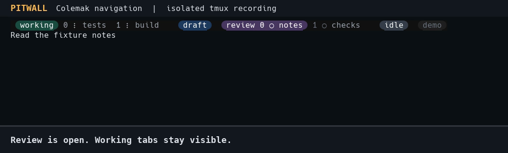

# 📁 dotfiles


## ✨ What is this?

This is my personal dotfiles repository. It contains all the configuration files for my system.

I'm using the [Colemak](https://colemak.com/) layout, so I have to change some keybindings in some programs like `tmux`, `vim`, `vscode`, etc.

## 💡 The navigation

Everything is based on _vim navigation_. Usually, you can navigate through the files with `hjkl` keys, but I've changed it for `hnei` keys. This because the Colemak layout has the `h` key in the same position, the `j` key is in the `n` position, the `k` key is in the `e` position and the `l` key is in the `i` position.

> **Note:** All the keys were mapped to the Colemak layout, this means that the `f` key (find char) is in the `t` position, the `d` key (delete char) is in the `s` position, etc.

Yep, it's a little bit confusing 🤯, but it's very useful when you're using the Colemak layout and/or you want easily switch to the `qwerty` layout.

## 📦 vim

The `vim` configuration is really basic. It contains just the basic Colemak keybindings and some general configurations.

### How to run it?

```bash
$ git clone https://github.com/mateonunez/dotfiles ~/.somewhere
$ ln -s ~/.somewhere/.vimrc ~/.vimrc
```

> Please backup your `~/.vimrc` file before running the previous command.

**Create the `swap` and `undo` directories**

```bash
$ mkdir ~/.vim/swap
$ mkdir ~/.vim/undo
```

## 📦 tmux

I really love [tmux](https://github.com/tmux/tmux), it's a great tool for managing your terminal sessions. I've created a basic configuration file for it, based on [oh-my-tmux](https://github.com/gpakosz/.tmux) and of course, with the Colemak keybindings (it uses the `vi navigation` to walk on the file).

The tmux prefix is `Ctrl-t`. Press the prefix, then the key below.

### Navigation

| Key after `Ctrl-t` | Action |
| --- | --- |
| `h` / `n` / `e` / `i` | Focus the pane to the left / below / above / right |
| `H` / `N` / `E` / `I` | Resize the pane to the left / down / up / right |
| `Ctrl-n` / `Ctrl-e` | Previous / next tab |
| `Ctrl-h` / `Ctrl-i` | Previous / next workspace |
| `l` | Return to the last active tab |
| `Shift-Tab` | Return to the last active workspace |

Workspace navigation follows the Pitwall bar when Automanaged is enabled and tmux session order otherwise. `Tab` shares the next-workspace shortcut so `Ctrl-i` works in terminals that send both keys as Tab.



[Watch the navigation demo (MP4)](assets/tmux-navigation.mp4)

### Copy mode

The copy mode is based on the `vi navigation`, so you can navigate through the text with `hnei` keys.

**Requirements:**

- On Linux: `xclip` package and `reattach-to-user-namespace`.
- On macOS: `pbcopy` package.
- On Windows: Who knows.

> For Linux and macOS, you can install the `reattach-to-user-namespace` package with `brew install reattach-to-user-namespace` or `sudo apt install reattach-to-user-namespace` and switch to the right program in the configuration file.

Press `Ctrl-t`, then `[` to enter copy mode. Move with `hnei` and select text with `v`. To copy the selection use one of these keys.

- j (y in qwerty): copy to the clipboard.
- Ctrl + c: copy to the clipboard and exit the copy mode.

### Agent lanes

[pitwall](https://github.com/mateonunez/pitwall) shows what each coding agent is doing: `◆` waiting for me, `✓` finished while I was elsewhere, a spinner while it works.

- **Tabs** expand the selected workspace. With Automanaged, Working stays expanded and Needs you leads the bar when it has a tab.
- **Dashboard** opens with `Ctrl-t`, then `Space` or `t`. Start typing to find a lane or workspace. Use `Ctrl-n/e` to move through results and `Enter` to open one.
- **Next lane that needs me** opens with `Ctrl-t`, then `a`. Press it again to cycle through lanes that need attention.
- **Restore** opens with `Ctrl-t`, then `R`. You can also run `pitwall restore` from a terminal.

`.tmux.conf.local` enables the Tabs layout and system metrics. Turn on Automanaged in **Settings → Feature Preview**. Run `pitwall keys` for the full list of dashboard shortcuts.

TPM can install Pitwall. This is how to link a local checkout instead.

```bash
$ git clone https://github.com/mateonunez/pitwall ~/src/pitwall
$ ln -s ~/src/pitwall ~/.tmux/plugins/pitwall
$ ln -s ~/src/pitwall/bin/pitwall ~/.local/bin/pitwall
$ pitwall install --write   # hooks for Claude Code and Codex
```

### How to run it?

```bash
$ git clone https://github.com/mateonunez/dotfiles ~/.somewhere
$ ln -s ~/.somewhere/.tmux.conf ~/.tmux.conf
$ ln -s ~/.somewhere/.tmux.conf.local ~/.tmux.conf.local
```

> Please backup your `~/.tmux.conf` and `~/.tmux.conf.local` files before running the previous commands.

## 📦 Ghostty

The `mateonunez` theme carries the mateonunez.co palette into the terminal: `#0a0a0a` background, Tailwind grays for text, an amber cursor, so tmux's status line and the terminal read as one surface.

```bash
$ mkdir -p ~/.config/ghostty
$ ln -s ~/.dotfiles/.config/ghostty/themes ~/.config/ghostty/themes
$ ln -s ~/.dotfiles/.config/ghostty/config.ghostty ~/.config/ghostty/config.ghostty
```

## 📦 nvim

A full IDE built on [lazy.nvim](https://github.com/folke/lazy.nvim), with Colemak-aware keymaps and one file per plugin. It's tuned to mirror my VS Code toolchain:

- **LSP & completion** — 14 servers (TS, Lua, Rust, Python, Tailwind, ESLint, YAML, TOML, CSS/HTML, Docker, Bash, clangd…) via Mason, `blink.cmp`, inlay hints, breadcrumbs + symbols outline.
- **Diagnostics & quality** — `nvim-lint` (eslint_d/ruff/shellcheck), `conform` formatting (Biome + Prettier + Stylua, manual via `<leader>z`), readable TS errors.
- **Debugging** — `nvim-dap` + dap-ui with VS Code's `F5`/`F9`/`F10`/`F11` keys (Python, JS/TS, Rust/C).
- **Testing** — `neotest` (jest/vitest/python), debug-a-test via DAP.
- **Git** — `gitsigns` (hunks + inline blame), `codediff` (diff/history/conflicts), `octo` (GitHub PRs), `lazygit`.
- **AI** — [Claude Code](https://github.com/coder/claudecode.nvim) in-editor (`<leader>a`).
- **Refactoring & editing** — `refactoring.nvim`, multiple cursors, surround, autopairs, Treesitter textobjects.
- **Navigation** — Telescope, Harpoon, Neo-tree, Trouble, grug-far, which-key.

📖 **Full guide → [.config/nvim/README.md](.config/nvim/README.md)** — install, the Colemak key map, the complete keybinding cheatsheet, and per-plugin notes.

```bash
$ git clone https://github.com/mateonunez/dotfiles ~/.somewhere
$ ln -s ~/.somewhere/.config/nvim ~/.config/nvim
```

> Back up your existing `~/.config/nvim` first. On first launch lazy.nvim installs every plugin (and Mason pulls the LSP/DAP/linter tools — give it a minute). `lazygit` and the `gh` CLI should be on your `PATH` for the git integrations.

## 🌳 Git worktree workspace

[`gwm`](https://github.com/kbrdn1/gwm-cli) provides a multi-repository TUI over
curated workspaces and every linked worktree, including worktrees created by
external coding agents. Each workspace is a persistent directory of relative
repository symlinks—the flat layout GWM expects. These directories are the
source of truth; VS Code `.code-workspace` files are unrelated and ignored.

The compact, stacked TUI uses the same black/surface/amber/blue/green/red
palette as tmux and Powerlevel10k. Its keymap mirrors the Colemak `hnei`
navigation used by Neovim, tmux, and lazygit.

Install and link the versioned configuration:

```bash
brew install kbrdn1/tap/gwm lumen
mkdir -p ~/.config/gwm ~/.config/lazygit ~/.local/bin
ln -s ~/.dotfiles/.config/gwm/config.toml ~/.config/gwm/config.toml
ln -s ~/.dotfiles/.config/gwm/workspaces ~/.config/gwm/workspaces
ln -s ~/.dotfiles/.config/lazygit/config.yml ~/.config/lazygit/config.yml
ln -s ~/.dotfiles/scripts/gwm-codediff ~/.local/bin/gwm-codediff
ln -s ~/.dotfiles/scripts/gwm-workspace ~/.local/bin/gwm-workspace
ln -s ~/.dotfiles/scripts/lumen-colemak ~/.local/bin/lumen-colemak
lumen-colemak
```

lumen hard-codes QWERTY `hjkl` and has no keymap config, so `lumen-colemak`
builds the latest release (or a given tag) with `patches/lumen-colemak.patch`
into `~/.local/bin`, ahead of Homebrew's copy. Re-run it after each lumen
release. The patch follows the lazygit reassignments:

| Action | lumen | Colemak |
| --- | --- | --- |
| down / up | `j` / `k` | `n` / `e` |
| scroll right | `l` | `i` |
| next / prev file | `ctrl+j` / `ctrl+k` | `ctrl+n` / `ctrl+e` |
| next / prev commit (stacked) | `ctrl+l` / `ctrl+h` | `I` / `H` |
| next / prev search match | `n` / `N` | `j` / `k` |
| edit file, edit annotation | `e` | `E` |
| annotate / all annotations | `i` / `I` | `a` / `A` |

List and open curated workspaces, or run GWM natively from the current folder:

```bash
gwm-workspace
gwm-workspace list
gwm-workspace open writing
```

Workspace homes live in `~/.config/gwm/workspaces` as `scope|directory`
entries. Every direct child directory is a workspace whose children are
repository symlinks. Names can be qualified (`personal/writing`) or short
when unique (`writing`).

Manage membership from the CLI:

```bash
gwm-workspace create personal/writing
gwm-workspace add writing ~/source/mateonunez/website
gwm-workspace repos writing
gwm-workspace remove writing website
```

From Neovim, use `<leader>gw` or `:GwmWorkspace` to choose between native GWM
for the directory where Neovim was launched and one of the curated symlink
workspaces. `:GwmWorkspace writing` opens a workspace directly;
`:GwmFolder [path]` opens native GWM from the launch directory or an explicit
folder. Use `:GwmWorkspaceAdd` and `:GwmWorkspaceRemove` to manage symlinks.
Quit GWM with `q`; the terminal closes and focus returns to the editor.

Set `GWM_WORKSPACES_FILE` to use a different workspace registry without editing
the versioned defaults.

Useful bindings:

- `n` / `e`: next / previous worktree (Colemak down / up)
- `N`: create a worktree
- `E`: rename the selected worktree
- `Enter`: exit into the selected worktree
- `l` / `L`: open lazygit in an overlay / fullscreen
- `r` / `R`: review the selected branch with Neovim + CodeDiff
- `u`: watch the selected worktree's uncommitted changes with [`lumen diff`](https://github.com/jnsahaj/lumen)
- `t`: open the worktree in a tmux pane
- `a`: inspect detected coding-agent sessions

The CodeDiff launcher resolves the selected base and head to commit IDs before
starting Neovim, then opens a PR-style three-dot comparison. Validate changes
to the configuration with:

```bash
gwm config validate
gwm-workspace list
gwm-workspace open writing list
```

`gwm doctor` currently operates on one repository at a time; run it from the
repository you want to diagnose.

---

## 📦 vscode

The `vscode` configuration contains just the generics settings and some keybindings to improve UX.

## 📦 zsh

Generic `zsh` configuration that contains some aliases, the theme and the plugins.

## 📝 License

[MIT](MIT).
